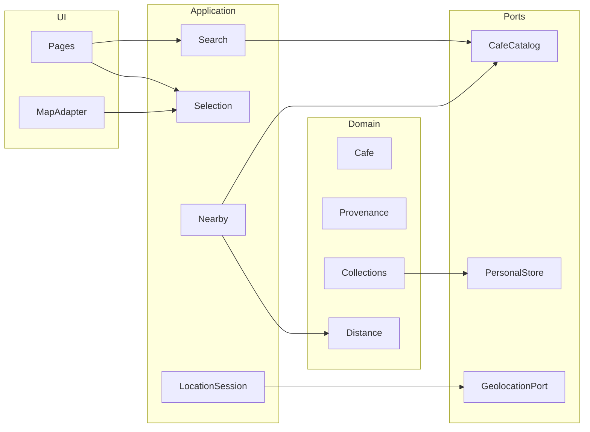

# Architecture

Temporary identifier: `cafe-finder-prototype`. This document is the target architecture. The stack table marks what exists. Supabase is not implemented. Phase limits are in [STATE.md](STATE.md).

## Stack

| Concern | Decision | Status |
| --- | --- | --- |
| UI | React, TypeScript, Vite SPA | Installed. Shell, routes, and fixture catalog screens exist. |
| Map renderer | MapLibre GL JS (BSD-3-Clause) | Installed in the map adapter. |
| Map tiles | Style URL from `VITE_MAP_STYLE_URL` | No provider is committed. A missing URL shows a configuration error. |
| Café data | `CafeCatalog` port; fixtures first | Labeled fixture catalog in `src/` |
| Personal data | `PersonalStore` port; `localStorage` first | `localStorage` adapter in `src/adapters/localPersonalStore.ts` |
| Remote data | Supabase Postgres with PostGIS | Intended, no project |
| Server rendering | Deferred | Shareable routes still exist |

Google Maps is not the map or the café source. Its pricing and terms would tie place data to a single vendor and restrict what the product can store.

The domain must not import React, MapLibre, Supabase, or the browser geolocation API. Those sit in adapters.

## Layers



- **Domain.** Café, provenance, collections, and distance. Pure functions. No I/O.
- **Application.** Search, selection, nearby queries, and the location session. Orchestrates ports.
- **Ports.** Interfaces for the catalog, personal storage, and geolocation.
- **Adapters.** Fixture catalog, `localStorage`, the browser Geolocation API, and MapLibre. Later, a Supabase catalog and a Supabase personal store.
- **UI.** Routes, the bottom sheet, and the map adapter. The map adapter turns café coordinates into markers. It does not decide which cafés exist.

## Three independent states

These states must not be collapsed into one “map center”.

### Location fix

The person’s last opted-in reading.

- `idle` — never requested
- `requesting` — the browser prompt is in progress
- `granted` — coordinates, accuracy in meters, and timestamp
- `denied` — the person or the browser refused
- `unavailable` — no position, or the request timed out
- `stale` — a granted fix older than the session threshold

A fix is created only after an explicit action. A foreground watch may update it while the map view is visible. The watch stops on navigation away, `visibilitychange` to hidden, deny, or unmount. No reading is appended to a trail.

### Viewport

Center, zoom, and bounds of the map. The person may pan away from the fix. Panning does not move the user marker, does not change the selected café, and does not recompute nearby results.

Recenter is a separate action: copy the latest fix into the viewport. If there is no fix, recenter asks for permission or explains why it cannot.

### Selection

One `selectedCafeId` or none. The result card, the marker highlight, and `/cafes/:id` read this id. Selecting a café may move the viewport to that café. It must not overwrite the location fix.

## Ports and first adapters

### CafeCatalog

```ts
interface CafeCatalog {
  list(): Promise<Cafe[]>;
  get(id: string): Promise<Cafe | null>;
}
```

First adapter: typed fixtures bundled with the app. Later adapter: Supabase, with nearby filtering pushed to PostGIS. UI code calls the port, not the adapter.

The catalog is not filtered by the viewport. Neighborhood, amenity, text, and optional nearby ranking happen in the application layer over catalog results. When PostGIS exists, nearby may be a catalog query, still behind the port, still using the location fix rather than the viewport.

### PersonalStore

```ts
interface PersonalStore {
  listFavorites(): Promise<Favorite[]>;
  listBucket(): Promise<BucketItem[]>;
  listVisits(): Promise<Visit[]>;
  saveFavorite(cafeId: string): Promise<void>;
  removeFavorite(cafeId: string): Promise<void>;
  saveBucket(cafeId: string): Promise<void>;
  removeBucket(cafeId: string): Promise<void>;
  recordVisit(cafeId: string, visitedAt: string): Promise<void>;
}
```

First adapter: `localStorage` on this device. Later adapter: Supabase rows protected by row-level security. The store never accepts a coordinate path.

### GeolocationPort

```ts
interface GeolocationPort {
  requestOnce(): Promise<LocationFix>;
  watch(onFix: (fix: LocationFix) => void): () => void;
}
```

`watch` returns an unsubscribe function. The location session must call it. The adapter wraps `navigator.geolocation` and nothing else. It does not talk to a third-party location SDK.

### Map adapter

MapLibre is constructed only in the map adapter. Configuration is a style URL, for example `VITE_MAP_STYLE_URL`, read at the edge of the app. The domain does not contain a tile hostname. If the URL is absent, the UI shows a configuration error.

Markers are derived from cafés whose coordinates are present. The user marker is derived from the location fix. Attribution required by the tile provider and by OpenStreetMap stays visible.

## Nearby and distance

Distance is a pure function of two WGS84 coordinates (haversine). Nearby ranking is a pure function of cafés, an origin fix, and a radius. Cafés without coordinates are excluded.

Accuracy is an input to presentation, not a reason to snap the user to a café. A coarse fix still sorts by distance, and the UI says the reading is approximate. The prototype does not auto-record a visit from proximity.

## Failure states

| Situation | Required behavior |
| --- | --- |
| Catalog loading | Show a loading state. Do not show placeholder cafés. |
| Catalog empty | Show an empty state. Leave the map usable. |
| Café id missing | Detail route explains that the café is not in the catalog. |
| Style URL missing | Map area explains that the map is not configured. List and search still work. |
| Location denied | Explain that nearby needs permission. Do not retry in a loop. |
| Location unavailable or timed out | Explain the failure. Keep the last fix only if it is still on screen as stale. |
| Page hidden | Stop the foreground watch. |
| No coordinates on a café | List and detail only. No marker. Not included in nearby. |

## Privacy

- Permission is opt-in and prompted by a user action.
- Coordinates stay in memory for the session except where a fix is deliberately held so the map can show it. They are not logged as a history.
- The prototype does not post coordinates to Supabase or to a tile provider as a café query. Tile requests will reveal the viewport to the tile host; that is a reason to document the chosen host before production, not a reason to add a tracking layer.
- Visits store the café id and the reported time only.

## Tile provider (unresolved)

The renderer is decided. The tiles are not.

| Candidate | Why it is in the list | Cost and license notes |
| --- | --- | --- |
| OpenFreeMap | No key for a prototype | No service commitment. Style may not match the editorial map. OSM attribution required. |
| MapTiler, or a similar hosted vector style | Custom muted style is easier | Needs a key. Free tier has a cap, then paid usage. OSM attribution still required for OSM-based data. |
| Protomaps PMTiles | Avoids per-view fees later | Needs hosting and a Philippines or Metro Manila extract. More work than the prototype should take on first. |

Do not create an account or commit a key in order to finish planning. When a provider is chosen, record the attribution duty and the spending cap in [STATE.md](STATE.md).

## Café source (unresolved)

There is no approved data vendor.

- OpenStreetMap, via a later Overpass or extract step, can seed names and coordinates under the Open Database License. Attribution is required. Hours, menus, prices, and photos from OSM stay unverified until a person checks them.
- Google Places is not a planned source. Caching and display rules conflict with an independent directory.
- The prototype catalog is fixtures with explicit provenance. Real Makati coverage is a curation phase after the adapters exist.

## Supabase shape (not created)

Intended tables follow [DATA_MODEL.md](DATA_MODEL.md). Café location is `geography(Point, 4326)`. Nearby uses `ST_DWithin` against the location fix. The client uses the anon key and row-level security. The service role key stays off the client.

No Supabase project exists. Phase 7 does not start without credentials supplied outside the repo. Photo storage is the first likely cost and is not part of the prototype.

## Extension points for a later companion

The companion is not designed here as a feature. The seams that keep it from contaminating the prototype:

- Visit recording is an application command. A future game module may subscribe to “a visit was recorded”. It must not be called by the map adapter.
- Proximity is a pure comparison of a fix and a café. It returns a yes or no. It does not write storage.
- The map adapter can later draw an extra layer. The domain does not learn about sprites, pets, or AR.
- Background location would be a new port implementation in a native shell, with its own consent. The web geolocation adapter must not grow a hidden watch to imitate it.

## Web, PWA, and native

The web app covers the prototype: foreground location, map, list, and local collections.

A later PWA may add a home-screen launch and an offline cache of the Makati catalog. It is the wrong place for background movement.

Native code is justified only when the product truly needs closed-app geofences, an AR companion, or battery-aware background location. That work is out of every phase in [MVP_SCOPE.md](MVP_SCOPE.md).
